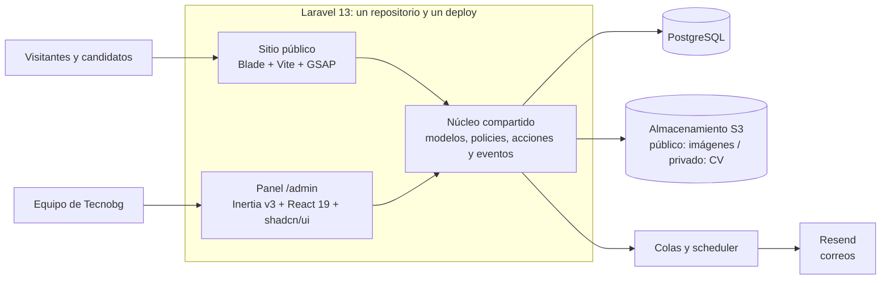
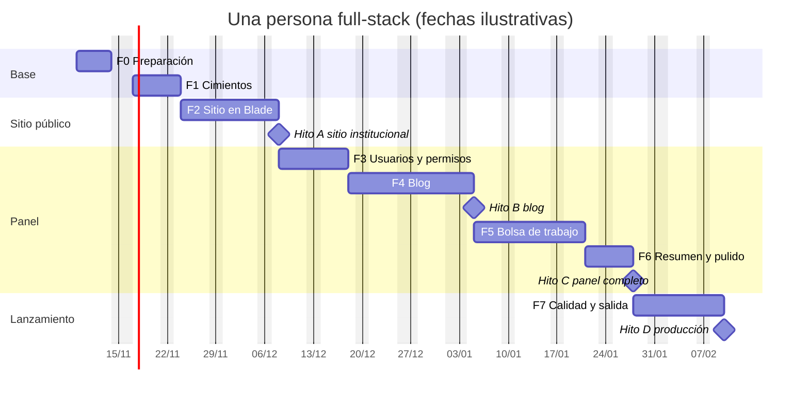

# Roadmap técnico: tecnobg.com en Laravel 13

Versión 1 · 3 de noviembre de 2026

Plan para llevar a producción, en una aplicación Laravel, el diseño final que ya está en `main` y publicado en Vercel (`final.html` y `final-paginas.html`) junto con la propuesta del [PR #3](https://github.com/Luot-h/prototypes-for-tecnobg-/pull/3): panel de administración (`admin.html`), blog, bolsa de trabajo, usuarios, roles y permisos. Las versiones de cada herramienta se revisaron en esta fecha (ver [Fuentes](#15-fuentes)).

## Contenido

1. [Resumen](#1-resumen)
2. [Punto de partida](#2-punto-de-partida)
3. [Arquitectura](#3-arquitectura)
4. [Stack y paqueterías](#4-stack-y-paqueterías)
5. [Modelo de datos](#5-modelo-de-datos)
6. [Roles y permisos](#6-roles-y-permisos)
7. [Rutas](#7-rutas)
8. [Fases](#8-fases)
9. [Cronograma](#9-cronograma)
10. [Forma de trabajo y calidad](#10-forma-de-trabajo-y-calidad)
11. [Seguridad y datos personales](#11-seguridad-y-datos-personales)
12. [Riesgos](#12-riesgos)
13. [Pendientes por confirmar con Tecnobg](#13-pendientes-por-confirmar-con-tecnobg)
14. [Después del lanzamiento](#14-después-del-lanzamiento)
15. [Fuentes](#15-fuentes)

## 1. Resumen

Una sola aplicación **Laravel 13** con dos caras:

| | Sitio público | Panel `/admin` |
|---|---|---|
| Quién lo usa | Clientes, candidatos y buscadores | Equipo de Tecnobg: Administrador, Editor de contenido y Recursos Humanos |
| Tecnología | Blade + Vite + GSAP, reutilizando el HTML, CSS y JS ya aprobados | Starter kit oficial de React: Inertia v3, React 19, TypeScript, Tailwind CSS 4 y shadcn/ui |
| Prioridad | SEO, velocidad y animaciones idénticas al diseño | Permisos, productividad y uso cómodo en celular |

Decisiones principales:

1. **Laravel 13**, la versión actual (salió el 17 de marzo de 2026 y recibe parches de seguridad hasta marzo de 2028), sobre **PHP 8.5**. El mínimo es PHP 8.4 porque lo exigen varias paqueterías de Spatie.
2. **Starter kit oficial de React para el panel.** Ya trae inicio de sesión, recuperación de contraseña, verificación en dos pasos (2FA), passkeys, perfil y un layout con barra lateral. Solo se quita el registro público.
3. **Sitio público en Blade, no en React.** El diseño ya está terminado en HTML, CSS y GSAP: en Blade se reutiliza casi entero, sale renderizado desde el servidor (lo mejor para SEO) y no carga React en páginas de marketing.
4. **Paqueterías probadas en lugar de código propio**: `spatie/laravel-permission` v8 con los mismos nombres de permiso de la propuesta (`blog.publicar`, `postulaciones.descargar-cv`…), más Media Library, Activitylog, Sluggable, Sitemap, Honeypot y Backup de Spatie.
5. **Infraestructura**: Laravel Cloud (con entornos de vista previa por PR, como hoy en Vercel), PostgreSQL, almacenamiento S3 con un disco privado para los CV y Resend para el correo, que ya se usa.

**Tiempo estimado:** unas 13 semanas con una persona full-stack (9 a 10 con dos), en 8 fases. El sitio institucional puede salir a producción al terminar la fase 2, antes que el blog y la bolsa de trabajo, como ya se había decidido para el lanzamiento («el sitio sale sin ellos»).

## 2. Punto de partida

| Pieza | Hoy | En Laravel |
|---|---|---|
| Portada | `final.html`, con CSS y JS en el mismo archivo y GSAP 3.12.5 desde cdnjs | Vista Blade `/` armada con componentes; CSS y JS empaquetados con Vite; GSAP desde npm |
| Páginas internas | `final-paginas.html`, una vista por `#hash`: Nosotros, Reparación, Mantenimiento preventivo, Pólizas, Emergencia y legales | Una URL real por página (`/nosotros`, `/reparacion`…), indexable por separado |
| Menú, pie y carruseles compartidos | `herramientas/generar-paginas.py` copia el HTML de un archivo a otro | Layout y componentes Blade (`<x-site.header>`, `<x-site.equipos linea="fria">`…) |
| Formulario de cotización | `api/cotizacion.js`: función de Vercel que envía a Resend | Controlador + Form Request + correo en cola, con el mismo Resend y la misma variable `RESEND_API_KEY` |
| Panel | `admin.html` del PR #3: maqueta sin backend con selector «Ver como» | Panel Inertia/React en `/admin`, con datos reales y permisos de Spatie |
| Blog y bolsa de trabajo públicos | Vistas `#blog`, `#blog-articulo`, `#bolsa-de-trabajo` y `#vacante` del PR #3 | Vistas Blade que leen de la base de datos |
| Tipografías e imágenes | `fonts/` (WOFF2) e `img/` (WebP) | Recursos de Vite con nombre versionado para caché larga |

Notas:

- El PR #3 sigue abierto y tiene conflictos con `main`, porque se hizo antes de las páginas del diseñador. No hace falta fusionarlo: `admin.html` y sus vistas públicas se toman como **especificación funcional**. Trae dos decisiones que se respetan aquí: **las postulaciones no se exportan** y hay **un solo campo de comentarios por candidato**.
- En `main`, Blog y Bolsa de trabajo se quitaron del menú y todavía no tienen el diseño final del diseñador; por eso el plan permite lanzar primero el sitio institucional.

## 3. Arquitectura



| Decisión | En lugar de | Por qué |
|---|---|---|
| Sitio público en Blade + Vite | Todo en Inertia/React con SSR | Reutiliza el HTML, CSS y GSAP aprobados casi sin cambios. El servidor entrega el HTML completo sin depender de un proceso de Node para SSR y sin hidratar páginas cargadas de animaciones. |
| Panel con el starter kit de React | Filament 5 (Livewire) | El kit ya resuelve autenticación, 2FA, passkeys y ajustes de la cuenta. Con shadcn/ui se reproduce fiel el diseño de `admin.html` (kanban, ficha lateral, matriz de permisos), que en Filament pediría plugins y se vería como Filament. Filament queda como plan B si el tiempo aprieta. |
| Monolito: un repositorio y un deploy | API + SPA por separado | Una sola sesión y un solo sistema de permisos, sin CORS ni tokens y con la mitad de infraestructura. Inertia da la experiencia de SPA sin escribir una API. |
| PostgreSQL | MySQL 8.4 | Sólido, con JSON nativo y búsqueda de texto en español si más adelante se agrega un buscador. Si el hosting impone MySQL, el código no cambia. |
| Laravel Cloud | Forge + VPS | Base de datos, bucket, colas y scheduler administrados, escalado a cero y vistas previas por PR (ilimitadas desde el plan Growth). Forge con un VPS sale más barato a gran escala, pero hay que mantener el servidor. |
| Colas en la base de datos | Redis + Horizon | El volumen (correos y conversiones de imágenes) es bajo. Si crece, se cambia a Redis con Horizon sin tocar el código. |

Este repositorio de prototipos se queda en Vercel como referencia de diseño. Vercel no es buen lugar para Laravel: no tiene colas, scheduler ni disco persistente.

## 4. Stack y paqueterías

### Base: starter kit oficial de React

```bash
laravel new tecnobg-web --react --pest --database=pgsql
```

| Pieza | Versión en el kit | Uso |
|---|---|---|
| `laravel/framework` | ^13 | |
| `inertiajs/inertia-laravel` + `@inertiajs/react` | ^3.0 | Páginas React sin escribir API. La v3 agrega actualizaciones optimistas, útiles en el kanban de postulaciones |
| `laravel/fortify` | ^1.37 | Inicio de sesión, recuperación de contraseña, 2FA y passkeys, con el registro desactivado |
| `laravel/wayfinder` | ^0.1 | Rutas de Laravel como funciones tipadas de TypeScript |
| React + React Compiler | 19.2 | |
| TypeScript | ^5.7 | |
| Tailwind CSS, shadcn/ui (Radix), lucide-react, sonner | Tailwind 4 | Tablas, diálogos, *Sheet* para la ficha de postulación y avisos |
| Vite+ (`vp dev`, `vp build`, `vp check`) | 1.4 | Compilación, lint y formato del frontend |
| Larastan, Pint, Sail, Pail | | Análisis estático, estilo de código, entorno local y logs |

### Backend

| Paquete | Uso en Tecnobg |
|---|---|
| `spatie/laravel-permission` ^8 | Roles y permisos `modulo.accion`. La v8 acepta enums de PHP |
| `spatie/laravel-medialibrary` ^11 | Portadas del blog con texto alternativo, imágenes del contenido (WebP y `srcset`) y CV en disco privado |
| `spatie/laravel-sluggable` ^4 | Slugs de artículos y vacantes |
| `spatie/laravel-activitylog` ^5 | «Actividad reciente» del resumen, historial de cada postulación y bitácora de auditoría |
| `spatie/laravel-query-builder` | Filtros, búsqueda, orden y paginación de las tablas del panel |
| `spatie/laravel-data` + `spatie/laravel-typescript-transformer` | DTOs para las props de Inertia y tipos de TypeScript generados desde PHP (enums incluidos) |
| `spatie/laravel-tags` | Etiquetas de los artículos |
| `spatie/laravel-sitemap` ^8 | `sitemap.xml` con páginas, artículos y vacantes abiertas |
| `spatie/schema-org` | JSON-LD: `Organization`, `BlogPosting`, `JobPosting` y `BreadcrumbList` |
| `spatie/laravel-honeypot` | Anti-spam en los formularios de cotización y postulación |
| `spatie/laravel-backup` ^10 | Respaldo diario de base de datos y archivos en otro bucket |
| `symfony/html-sanitizer` | Limpia el HTML del editor antes de guardarlo (evita XSS) |
| `resend/resend-php` | Driver `resend` de Laravel para el correo |
| `laravel-lang/common` | Mensajes de validación, autenticación y paginación en español |
| `laravel/nightwatch` (o Sentry) | Errores, consultas lentas y trabajos fallidos |
| `laravel/boost` (desarrollo) | Da a los agentes de IA, como Claude Code, la documentación de Laravel 13 y de las paqueterías instaladas |

### Frontend del panel

| Librería | Uso |
|---|---|
| `@tanstack/react-table` | Tablas con el patrón *Data Table* de shadcn y paginación del servidor |
| Tiptap 3 (`@tiptap/react`) | Editor de artículos con la barra de la propuesta: H2, H3, negritas, cursivas, enlace, listas, cita, imagen y video |
| `@dnd-kit/core` y `@dnd-kit/sortable` | Arrastrar postulaciones entre etapas, también con teclado |
| `date-fns` (locale `es`) | Fechas como «hace 2 h» o «14 oct 2026» |

### Sitio público

| Pieza | Uso |
|---|---|
| `gsap` desde npm, con ScrollTrigger | Las mismas animaciones de hoy. Desde la versión 3.13 todos los plugins de GSAP son gratuitos, incluido SplitText |
| Tipografías servidas desde el sitio | Recharge, HP Simplified, Lexend y Barlow Condensed sin llamar a Google Fonts |
| JavaScript sin framework, en módulos | Menú, pestañas, diálogos y carruseles ya existen así; no hace falta Alpine ni React |

### Calidad

Pest 4 (incluye pruebas de navegador con Playwright), Larastan, Pint, `vp check` y GitHub Actions.

## 5. Modelo de datos

Convención: el código va en inglés (modelos, tablas, clases), como espera Laravel; las URLs, los nombres de permiso y los textos van en español, como en la propuesta.

| Tabla | Campos principales | Notas |
|---|---|---|
| `users` | `name`, `email`, `password`, campos de 2FA del kit, `is_active`, `last_login_at`, `invitation_accepted_at` | Sin registro público: el alta es por invitación |
| `roles`, `permissions` y pivotes | Tablas de Spatie, más `description` y `color` en `roles` | El color pinta la etiqueta de cada rol, como en la propuesta |
| `categories` | `name`, `slug`, `position` | Línea fría, Línea caliente, Mantenimiento y Operación |
| `posts` | `title`, `slug`, `excerpt`, `body` (HTML ya limpio), `status`, `published_at`, `is_featured`, `author_id`, `category_id`, `seo_title`, `seo_description`, `reading_minutes`, borrado lógico | Portada con su texto alternativo en Media Library; etiquetas con `spatie/laravel-tags` |
| `job_openings` | `title`, `slug`, `area`, `location`, `employment_type`, `schedule`, `salary`, `salary_negotiable`, `description`, `responsibilities`, `requirements`, `benefits`, `status`, `closes_at`, `asks_cv`, `cv_required`, `notify_email`, borrado lógico | Responsabilidades, requisitos y «Ofrecemos» como listas JSON (una línea, un elemento) |
| `job_applications` | `job_opening_id` (vacío = CV espontáneo), `name`, `email`, `phone`, `city`, `experience`, `message`, `stage`, `comments`, `privacy_accepted_at`, `privacy_notice_version`, `ip_address` | CV en Media Library sobre el disco privado; el historial de etapas sale de la bitácora |
| `media`, `activity_log`, `tags` | Tablas de Spatie | |

Enums de PHP, cada uno con `label()` y `color()` para las etiquetas del panel y exportados a TypeScript:

- `PostStatus`: borrador y publicado. «Programado» es un artículo publicado con fecha futura, así que aparece solo a su hora, sin tareas programadas.
- `JobOpeningStatus`: abierta, pausada y cerrada.
- `EmploymentType`: tiempo completo, medio tiempo y por proyecto.
- `JobArea`: operaciones, comercial y administración (si Tecnobg quiere administrar las áreas, se pasa a tabla).
- `ApplicationStage`: nueva, en revisión, entrevista, contratado y descartado.
- `ExperienceRange`: menos de 1 año, 1 a 3, 3 a 5 y más de 5.
- `PermissionsEnum` y `RolesEnum`: ver la sección siguiente.

## 6. Roles y permisos

Los 19 permisos y los tres roles iniciales salen tal cual de la matriz de `admin.html`:

| Módulo | Permisos | Administrador | Editor de contenido | Recursos Humanos |
|---|---|:-:|:-:|:-:|
| Blog | `blog.ver` `blog.crear` `blog.editar` `blog.publicar` `blog.eliminar` | ✓ | ✓ | |
| Vacantes | `vacantes.ver` `vacantes.crear` `vacantes.editar` `vacantes.publicar` `vacantes.eliminar` | ✓ | | ✓ |
| Postulaciones | `postulaciones.ver` `postulaciones.cambiar-estado` `postulaciones.descargar-cv` | ✓ | | ✓ |
| Postulaciones | `postulaciones.eliminar` | ✓ | | |
| Usuarios | `usuarios.ver` `usuarios.crear` `usuarios.editar` `usuarios.eliminar` | ✓ | | |
| Roles | `roles.gestionar` | ✓ | | |

Cómo se implementa:

- **Una sola lista de permisos** en un enum respaldado por string. La usan el seeder, las rutas, las policies y, generada a TypeScript, el frontend. El seeder es idempotente (`findOrCreate`) y corre en cada deploy, así que agregar un permiso es agregar un caso al enum.
- **El Administrador siempre puede todo**, con `Gate::before`. El seeder también le asigna todos los permisos, para que el frontend los vea, y su rol no se puede editar (en la interfaz y en la policy).
- **El servidor decide**: middleware `permission:` por módulo en las rutas y policies por modelo. Si alguien escribe la URL a mano sin permiso, recibe la página «Sin permiso» (403), que Inertia muestra con el diseño de la propuesta.
- **La interfaz solo oculta**: los permisos del usuario se comparten con Inertia y un hook `useCan()` muestra u oculta menú, botones y tarjetas, igual que los atributos `data-perm` de `admin.html`.
- **Invitación en lugar de registro**: se crea el usuario con su rol y se le envía un enlace firmado con vigencia de 72 horas a la pantalla «Crea tu contraseña», con el estilo del login. El enlace deja de servir en cuanto se usa.
- **Desactivar en vez de borrar** (`is_active`): un usuario desactivado no puede entrar y, si tenía sesión abierta, se cierra. No se puede desactivar a uno mismo ni al último Administrador. El «Último acceso» se guarda con el evento `Login`.
- **2FA obligatoria para Administrador** (recomendado) y opcional para los demás; las passkeys ya vienen en el kit.
- **Bitácora**: cambios de permisos, altas y bajas de usuarios y descargas de CV quedan en `activity_log`.
- El selector «Ver como» era solo para revisar la propuesta y no se programa; lo sustituyen pruebas automáticas por rol.

```php
// app/Enums/PermissionsEnum.php
enum PermissionsEnum: string
{
    case BlogVer = 'blog.ver';
    case BlogCrear = 'blog.crear';
    case BlogEditar = 'blog.editar';
    case BlogPublicar = 'blog.publicar';
    case BlogEliminar = 'blog.eliminar';
    // … vacantes.*, postulaciones.*, usuarios.*
    case RolesGestionar = 'roles.gestionar';
}

// app/Providers/AppServiceProvider.php
Gate::before(fn (User $user) => $user->hasRole(RolesEnum::Administrador) ? true : null);

// routes/admin.php
Route::prefix('admin')->name('admin.')->middleware(['auth', 'active'])->group(function () {
    Route::get('/', DashboardController::class)->name('dashboard');
    Route::middleware('permission:blog.ver')->group(function () {
        Route::resource('blog', PostController::class)->parameters(['blog' => 'post']);
    });
    // vacantes, postulaciones, usuarios y roles igual
});

// app/Http/Middleware/HandleInertiaRequests.php, dentro de share()
'auth' => [
    'user' => $request->user()?->only('id', 'name', 'email'),
    'permissions' => fn () => $request->user()?->getAllPermissions()->pluck('name') ?? [],
],
```

```tsx
// resources/js/hooks/use-can.ts
export function useCan() {
    const { auth } = usePage<SharedData>().props;
    return (permission: Permission) => auth.permissions.includes(permission);
}
```

## 7. Rutas

### Sitio público

| Hoy (prototipo) | Laravel | Notas |
|---|---|---|
| `final.html` | `/` | |
| `#nosotros` | `/nosotros` | El video de YouTube carga con una fachada (`youtube-nocookie`) solo cuando hace falta |
| `#reparacion`, `#reparacion-linea-fria` | `/reparacion`, `/reparacion#linea-fria` | Igual con línea caliente |
| `#mantenimiento-preventivo` | `/mantenimiento-preventivo` | Con sus anclas de línea fría y caliente |
| `#polizas` | `/polizas` | |
| `#servicio-de-emergencia` | `/servicio-de-emergencia` | |
| `#blog`, `#blog-articulo` | `/blog`, `/blog/categoria/{slug}`, `/blog/{slug}` | El filtro por categoría tiene URL propia e indexable |
| `#bolsa-de-trabajo`, `#vacante` | `/bolsa-de-trabajo`, `/bolsa-de-trabajo/{slug}` | Postulación en `POST /bolsa-de-trabajo/{slug}/postulacion`; el CV espontáneo usa el mismo formulario sin vacante |
| `#aviso-de-privacidad`, `#terminos-y-condiciones`, `#uso-de-cookies` | Las mismas rutas, sin `#` | Textos pendientes de Tecnobg |
| `/api/cotizacion` | `POST /cotizacion` | Mismas reglas que `api/cotizacion.js` |
| | `/sitemap.xml`, `/robots.txt` | `robots.txt` bloquea todo fuera de producción |

Antes de publicar hay que cruzar esta lista con las URLs actuales de tecnobg.com y redirigir con 301 las que cambien.

### Panel `/admin`

| Pantalla de `admin.html` | Ruta | Permiso | Implementación |
|---|---|---|---|
| Iniciar sesión, recuperar contraseña | `/admin/login`, `/admin/forgot-password` | Visitante | Fortify y las páginas del kit con el estilo de la propuesta |
| Resumen | `/admin` | Sesión iniciada | Tarjetas y listas según los permisos; indicadores como props diferidas |
| Blog | `/admin/blog` | `blog.ver` | Pestañas con conteo, búsqueda, categoría y paginación |
| Editar artículo | `/admin/blog/crear`, `/admin/blog/{post}/editar` | `blog.crear` o `blog.editar`; publicar o programar pide `blog.publicar` | Tiptap, Media Library, autoguardado de borradores y vista previa con URL firmada |
| Categorías | Diálogo dentro de Blog | `blog.editar` | |
| Vacantes | `/admin/vacantes` | `vacantes.ver` | |
| Editar vacante | `/admin/vacantes/crear`, `/admin/vacantes/{vacante}/editar` | `vacantes.crear` o `vacantes.editar`; abrir, pausar o cerrar pide `vacantes.publicar` | |
| Postulaciones | `/admin/postulaciones` | `postulaciones.ver` | Kanban de 5 etapas con dnd-kit y actualización optimista; ficha en *Sheet* |
| Descargar CV | `/admin/postulaciones/{postulacion}/cv` | `postulaciones.descargar-cv` | Se entrega desde un controlador y queda en la bitácora |
| Usuarios | `/admin/usuarios` | `usuarios.ver`, `crear`, `editar`; `eliminar` desactiva | Invitación por correo |
| Roles y permisos | `/admin/roles` | `roles.gestionar` | Matriz de casillas que guarda con `syncPermissions()` |
| Mi perfil | `/admin/ajustes/…` | Sesión iniciada | Ajustes del kit: perfil, contraseña, 2FA y passkeys |
| Sin permiso | Respuesta 403 | | Página de error de Inertia con el diseño de la propuesta |

Las rutas del panel van en español con `Route::resourceVerbs(['create' => 'crear', 'edit' => 'editar'])`.

## 8. Fases

Cada fase termina con algo que se puede revisar en un entorno de vista previa. «Listo cuando» es la condición para pasar a la siguiente.

### Fase 0 · Preparación (1 semana)

- [ ] Crear el repositorio nuevo `tecnobg-web`. Este repositorio se queda como referencia de diseño.
- [ ] Pedir a Tecnobg lo que bloquea fases posteriores (sección 13), sobre todo el aviso de privacidad, los correos de ventas y RH, las URLs actuales y el acceso al DNS.
- [ ] Cerrar dudas de la propuesta: plazo de conservación de CV, cómo funciona el CV espontáneo y quién puede abrir vacantes.
- [ ] Crear cuentas: Laravel Cloud, bucket S3 (o R2) y dominio verificado en Resend.
- [ ] Revisar el modelo de datos y los enums de la sección 5.
- [ ] Acordar la forma de trabajo de la sección 10.

**Listo cuando:** el repositorio existe, cada pendiente tiene responsable y fecha, y el modelo de datos está aprobado.

### Fase 1 · Cimientos (1 semana)

- [ ] Crear la app con el starter kit de React y Pest.
- [ ] Quitar `Features::registration()` y la verificación de correo de `config/fortify.php` (con su página y sus pruebas), y mover el login, los ajustes y el panel a `/admin` (`prefix` y `home` de Fortify).
- [ ] Todo en español: `APP_LOCALE=es`, `APP_FAKER_LOCALE=es_MX`, zona horaria `America/Mexico_City`, `laravel-lang/common` y verbos de ruta en español.
- [ ] Instalar y configurar las paqueterías de la sección 4, Resend y Nightwatch.
- [ ] `PermissionsEnum`, `RolesEnum`, seeder idempotente de roles y permisos, y el primer Administrador desde variables de entorno.
- [ ] Tema del panel con los colores y tipografías de la propuesta (`#191c37`, `#1e2d5f`, `#334f9d`, degradado `#4cc1f0 → #148bcc`; Lexend, HP Simplified y Recharge): barra lateral oscura con los grupos *Contenido*, *Bolsa de trabajo* y *Administración*, y login sobre fondo degradado.
- [ ] CI en GitHub Actions: Pint, Larastan, Pest, `vp check` y compilación.
- [ ] Staging en Laravel Cloud con base de datos, bucket, cola y scheduler, más un entorno de vista previa por PR.

**Listo cuando:** un Administrador entra a `/admin/login` en staging con 2FA, `/register` no existe y el CI pasa.

### Fase 2 · Sitio público en Blade (2 semanas)

- [ ] Layout Blade con `<head>` completo (SEO, Open Graph, fuentes precargadas) y header y footer como componentes.
- [ ] Portar `final.html` por secciones a componentes: portada, servicios por escenas, línea fría y caliente con su diálogo de equipos, proceso, beneficios, experiencia, preguntas frecuentes y cotización.
- [ ] Portar las páginas de `final-paginas.html` a sus rutas. Los carruseles de equipos que hoy copia el script de Python se vuelven un componente reutilizado en la portada, Reparación y Mantenimiento preventivo.
- [ ] CSS en archivos por sección empaquetados por Vite, sin reescribirlo en Tailwind. JS en módulos con `gsap` y `ScrollTrigger` desde npm, respetando `prefers-reduced-motion`.
- [ ] Listas de equipos, preguntas frecuentes y clientes como datos (config o arrays) en lugar de HTML repetido.
- [ ] Cotización: `POST /cotizacion` con las mismas reglas que `api/cotizacion.js`, honeypot, límite por IP y correo en cola por Resend con `reply-to` del cliente. Responde JSON para que el JS actual no cambie.
- [ ] SEO técnico: título y descripción por página, canonical, Open Graph, JSON-LD de la empresa, `sitemap.xml`, `robots.txt` por entorno y `X-Robots-Tag: noindex` fuera de producción.
- [ ] Rendimiento: imagen de portada con `fetchpriority="high"`, `width` y `height` en todas las imágenes, fachada para YouTube y caché larga de recursos versionados.
- [ ] Pruebas de navegador con Pest 4: cada página responde, sin errores de consola y sin scroll horizontal a 390 px, lo mismo que hoy se revisa a mano con Playwright.

**Listo cuando:** staging se ve igual que `/final` de Vercel a 1440 y 390 px, Lighthouse móvil da 90 o más en Rendimiento, Accesibilidad y SEO, y la cotización llega al correo de ventas.

**Hito A: sitio institucional listo.** Si se lanza aquí, se adelantan de la fase 7 el DNS, las redirecciones 301, los respaldos y el monitoreo.

### Fase 3 · Panel: usuarios, roles y permisos (1.5 semanas)

- [ ] Layout como `admin.html`: barra lateral con el menú filtrado por permisos y el contador de postulaciones nuevas; barra superior con migas, «Ver sitio» y avatar; menú hamburguesa en celular.
- [ ] Permisos compartidos con Inertia, `useCan()` y página «Sin permiso».
- [ ] Usuarios: tabla con búsqueda, filtro por rol, estado y último acceso; invitar (nombre, correo y rol), editar, desactivar y reactivar, reenviar invitación.
- [ ] Roles: lista con número de usuarios y de permisos, matriz por módulo, crear rol con nombre y descripción, y Administrador bloqueado.
- [ ] Middleware por módulo, policies y bitácora de cambios.
- [ ] Pruebas con un dataset rol × ruta que espera 200 o 403 para los tres roles.

**Listo cuando:** cada rol ve exactamente lo que mostraba «Ver como» en la propuesta y el servidor responde 403 aunque la URL se escriba a mano.

### Fase 4 · Blog (2 semanas)

Panel:

- [ ] Tabla con pestañas Todos, Publicados, Programados y Borradores (con sus conteos), búsqueda, filtro por categoría y paginación del servidor.
- [ ] Editor: título, slug automático y editable, extracto, contenido en Tiptap, SEO (título de hasta 60 caracteres, descripción de hasta 155 y vista previa de Google), estado y fecha, autor, «Destacar en el blog», portada con texto alternativo, categoría y etiquetas.
- [ ] Sin `blog.publicar` solo se guardan borradores.
- [ ] Autoguardado de borradores en segundo plano, vista previa con URL firmada, borrado lógico con confirmación y categorías en un diálogo.
- [ ] HTML del editor limpiado en el servidor; imágenes del contenido en Media Library, convertidas a WebP en varios tamaños.

Sitio:

- [ ] `/blog`: artículo destacado, filtro por categoría y paginación.
- [ ] `/blog/{slug}`: portada, autor, fecha y minutos de lectura, llamada a cotizar o escribir por WhatsApp, botones para compartir y artículos relacionados de la misma categoría.
- [ ] SEO: JSON-LD `BlogPosting` y `BreadcrumbList`, imagen Open Graph de 1200 × 630 desde la portada y entrada en el sitemap. Si cambia el slug de un artículo publicado, el anterior redirige con 301.

**Listo cuando:** un Editor crea, programa y publica un artículo que aparece en `/blog` a su hora con metadatos correctos, y Recursos Humanos recibe 403 en el blog.

**Hito B: blog listo.**

### Fase 5 · Bolsa de trabajo y postulaciones (2.5 semanas)

Panel, vacantes:

- [ ] Tabla con pestañas Todas, Abiertas, Pausadas y Cerradas, búsqueda y número de postulaciones, que enlaza al kanban filtrado.
- [ ] Formulario de la propuesta: puesto, área, ubicación, jornada, horario, sueldo opcional o «Sueldo a tratar», sobre el puesto, responsabilidades, requisitos y «Ofrecemos» (uno por línea), estado, fecha de cierre, pedir CV, CV obligatorio y correo de aviso.
- [ ] Cierre automático al pasar la fecha (comando diario). Al borrar una vacante se conservan sus postulaciones.

Sitio:

- [ ] `/bolsa-de-trabajo`: vacantes abiertas, filtro por área y «¿No ves tu puesto?» para el CV espontáneo.
- [ ] `/bolsa-de-trabajo/{slug}`: detalle y formulario con nombre, correo, teléfono, ciudad o alcaldía, años de experiencia, CV en PDF de hasta 5 MB, mensaje y aceptación del aviso de privacidad.
- [ ] Formulario seguro: el PDF se valida por su tipo real, honeypot, límite por IP, archivo en disco privado y consentimiento registrado (fecha, versión del aviso e IP).
- [ ] Correos en cola: confirmación al candidato y aviso al correo de la vacante con un enlace al panel, sin adjuntar el CV.
- [ ] JSON-LD `JobPosting` para Google for Jobs: fecha de publicación, `validThrough`, tipo de empleo, ubicación y sueldo si se muestra. Una vacante cerrada pierde el JSON-LD, sale del sitemap y muestra «Esta vacante ya no está disponible».

Panel, postulaciones:

- [ ] Kanban con Nueva, En revisión, Entrevista, Contratado y Descartado; filtro por vacante; arrastrar entre columnas con actualización optimista (pide `postulaciones.cambiar-estado`).
- [ ] Ficha lateral: cambiar estado, datos de contacto, descargar CV (pide `postulaciones.descargar-cv` y queda en la bitácora), mensaje del candidato, comentarios internos en un solo campo e historial.
- [ ] Sin exportación, como se decidió en el PR #3.
- [ ] Borrado automático de postulaciones y CV al vencer el plazo acordado, con `Prunable` (no `MassPrunable`, para que Media Library también borre el PDF).

**Listo cuando:** alguien se postula desde el celular con un PDF, RH recibe el aviso, mueve la tarjeta por las etapas y descarga el CV; un Editor recibe 403; y la vacante pasa la prueba de resultados enriquecidos de Google.

### Fase 6 · Resumen y pulido del panel (1 semana)

- [ ] Resumen como en `admin.html`: saludo, accesos rápidos (Nuevo artículo, Nueva vacante) según permisos, indicadores (artículos publicados y del mes, vacantes abiertas y nuevas, postulaciones sin revisar), postulaciones recientes, borradores y programados, y actividad reciente.
- [ ] Estados vacíos, confirmaciones antes de borrar, avisos, estados de carga y revisión en celular.
- [ ] Accesibilidad: foco visible, todo usable con teclado (también el kanban) y contraste suficiente.

**Listo cuando:** el panel coincide con `admin.html` en escritorio y celular, salvo «Ver como».

**Hito C: panel completo.**

### Fase 7 · Calidad, seguridad y lanzamiento (1.5 semanas)

- [ ] Seguridad: cabeceras (CSP y HSTS), 2FA obligatoria para Administrador, cookies seguras y `composer audit` y `npm audit` en el CI.
- [ ] Respaldos diarios con `spatie/laravel-backup` en otro bucket y una **prueba de restauración**.
- [ ] Monitoreo: Nightwatch (o Sentry), disponibilidad y alertas de trabajos fallidos.
- [ ] Caché: `php artisan optimize` en cada deploy y caché de páginas públicas que se limpia al guardar contenido y vence en pocos minutos, para que los artículos programados aparezcan a su hora.
- [ ] Pruebas de navegador de los flujos críticos: login, publicar artículo, postularse y mover una postulación.
- [ ] Salida: redirecciones 301 desde las URLs actuales, quitar `noindex`, DNS y SSL, SPF, DKIM y DMARC para Resend, alta en Google Search Console con el sitemap y banner de cookies si se usa GA4.
- [ ] Entrega: guía corta para Tecnobg (publicar un artículo, abrir una vacante, dar seguimiento a postulaciones, dar de alta usuarios) y documentación técnica en el repositorio.

**Listo cuando:** tecnobg.com corre en producción, los respaldos están probados, el monitoreo está activo y el equipo de Tecnobg sabe usar el panel.

**Hito D: producción.**

## 9. Cronograma

Fechas ilustrativas con una persona full-stack, empezando el lunes 9 de noviembre de 2026. Descuenta fines de semana y los días de descanso obligatorio (16 nov, 25 dic, 1 ene y 1 feb), pero no vacaciones de fin de año.



| Hito | Qué incluye | Fecha ilustrativa |
|---|---|---|
| A | Sitio institucional en Laravel, listo para reemplazar al actual | 7 dic 2026 |
| B | Blog administrable | 4 ene 2027 |
| C | Bolsa de trabajo, postulaciones y panel completo | 27 ene 2027 |
| D | Todo en producción | 9 feb 2027 |

**Con dos personas** el plan baja a unas 9 o 10 semanas: tras las fases 0 y 1 juntas, una persona toma el sitio público (fase 2, vistas públicas del blog y la bolsa de trabajo, SEO y salida) y la otra el panel (fases 3 a 6).

## 10. Forma de trabajo y calidad

- **Definition of Done**: PR chico con pruebas; CI en verde (Pint, Larastan nivel 6 o más, Pest y `vp check`); revisado en su entorno de vista previa; capturas a 1440 y 390 px si cambia la interfaz; textos en español.
- **Código**: controladores delgados; Form Requests para validar, policies para autorizar, enums para estados y clases de acción para la lógica del negocio (`PublishPost`, `SubmitJobApplication`, `MoveApplicationToStage`, `InviteUser`); efectos secundarios como correos en eventos y colas.
- **Pruebas de backend** (Pest): permisos por rol, reglas de publicación (con viaje en el tiempo para los programados), formularios con `Storage::fake()` y `Mail::fake()`, y borrado automático de datos.
- **Pruebas de navegador** (Pest 4 con Playwright): páginas públicas y flujos críticos del panel.
- **Entornos**: local con Laravel Herd o Sail, vista previa por PR, staging y producción. `main` protegida y paso a producción manual.

## 11. Seguridad y datos personales

Las postulaciones guardan datos personales y CV, así que, conforme a la Ley Federal de Protección de Datos Personales en Posesión de los Particulares:

- La bolsa de trabajo no se publica sin el aviso de privacidad; la aceptación queda registrada con fecha, versión del aviso e IP.
- Los CV viven en un disco privado y solo los descarga quien tiene `postulaciones.descargar-cv`; cada descarga queda en la bitácora.
- Los correos avisan de la postulación con un enlace al panel, sin adjuntar el CV.
- Las postulaciones y sus CV se borran solos al vencer el plazo acordado, y una persona con `postulaciones.eliminar` puede borrarlos antes si el candidato lo pide (derechos ARCO).
- El HTML del blog se limpia antes de guardarse, los formularios públicos tienen honeypot y límite por IP, y el login de Fortify ya limita los intentos.

## 12. Riesgos

| Riesgo | Impacto | Mitigación |
|---|---|---|
| Faltan el aviso de privacidad y los textos legales | Sin aviso no se pueden recibir CV; la fase 5 no sale | Pedirlos en la fase 0; la bolsa de trabajo no se publica sin aviso |
| Blog, bolsa de trabajo y legales siguen sin diseño final | Retrabajo visual | Usar las vistas del PR #3, que ya siguen el estilo de `/final`; Blade separa el diseño de la lógica |
| Licencias web de Recharge y HP Simplified sin confirmar; Acumin Condensed sin entregar | Uso no autorizado o tipografía sustituta | Confirmar con el diseñador antes de producción; Barlow Condensed se queda de respaldo |
| Las escenas fijadas con ScrollTrigger cambian al portarlas | Diferencias con el diseño aprobado | Portar el JS sin reescribirlo y comparar capturas a 1440 y 390 px en cada PR |
| Pérdida de posicionamiento al cambiar de sitio | Menos visitas desde Google | Inventario de URLs, redirecciones 301, sitemap y Search Console el día del cambio |
| Spam en los formularios | Correos basura y CV falsos | Honeypot y límite por IP; Cloudflare Turnstile si aparece spam |
| Fuga de datos de candidatos | Riesgo legal y de reputación | Disco privado, permiso específico, bitácora y borrado automático |
| Crecimiento del alcance | Retraso | Respetar las decisiones del PR #3; lo nuevo va a la sección 14 |
| Paquetes jóvenes (Wayfinder 0.x, Inertia 3) | Cambios que rompen | Versiones fijadas en los archivos lock y actualizaciones en su propio PR, con pruebas |

## 13. Pendientes por confirmar con Tecnobg

- [ ] Aviso de privacidad (indispensable para la bolsa de trabajo), términos y condiciones y política de cookies.
- [ ] Correo que recibe las cotizaciones (hoy `ventas@tecnobg.com`) y correo de RH para los avisos de postulación.
- [ ] Plazo de conservación de postulaciones y CV (propuesta: 12 meses).
- [ ] Lista de URLs actuales de tecnobg.com y acceso al DNS y al hosting actual.
- [ ] Licencias web de las tipografías y el archivo de Acumin Condensed.
- [ ] Si el diseñador entregará el diseño final de Blog, Bolsa de trabajo y legales.
- [ ] Quiénes tendrán los roles de Administrador, Editor de contenido y Recursos Humanos al arrancar.
- [ ] Analítica: GA4 (requiere banner de cookies) u otra herramienta.
- [ ] Dominio de correo para Resend, con SPF, DKIM y DMARC.

## 14. Después del lanzamiento

- **Cotizaciones en el panel**: guardar cada solicitud del formulario y darle seguimiento por etapas, como a las postulaciones. Hoy solo llegan por correo.
- **Contenido del sitio editable**: preguntas frecuentes, listas de equipos y logos de clientes.
- **Ayudas con el AI SDK de Laravel**: sugerir título y descripción SEO de un artículo o el texto alternativo de una imagen.
- **Aviso en tiempo real** de nuevas postulaciones con Laravel Reverb.
- **RSS del blog** con `spatie/laravel-feed`.

## 15. Fuentes

Revisadas el 3 de noviembre de 2026.

- [laravel/react-starter-kit](https://github.com/laravel/react-starter-kit): `composer.json` y `package.json` de la rama principal. Laravel ^13.17, PHP ^8.3, Inertia ^3.0, Fortify ^1.37, Wayfinder ^0.1, React ^19.2, Tailwind 4, Vite+ 1.4 y `@laravel/passkeys`.
- [Starter kits en la documentación de Laravel 13](https://laravel.com/docs/13.x/starter-kits).
- [Ciclo de versiones de Laravel](https://laravel-news.com/laravel-releases) y [Laravel 13](https://benjamincrozat.com/laravel-13): salió el 17 de marzo de 2026; corrección de errores hasta el tercer trimestre de 2027 y de seguridad hasta el 17 de marzo de 2028.
- [Inertia 3.0.0](https://laravel-news.com/inertia-3-0-0): actualizaciones optimistas y sin Axios.
- [spatie/laravel-permission](https://github.com/spatie/laravel-permission): la 8.0.0 salió el 30 de mayo de 2026 y acepta enums en `findByName()` y `findOrCreate()`.
- `composer.json` de [laravel-medialibrary](https://github.com/spatie/laravel-medialibrary) (11.x), [laravel-activitylog](https://github.com/spatie/laravel-activitylog) (5.x, PHP 8.4+), [laravel-sitemap](https://github.com/spatie/laravel-sitemap) (8.x, PHP 8.4+), [laravel-query-builder](https://github.com/spatie/laravel-query-builder) (PHP 8.4+), [schema-org](https://github.com/spatie/schema-org) (PHP 8.4+), [laravel-backup](https://github.com/spatie/laravel-backup) (10.x), [laravel-sluggable](https://github.com/spatie/laravel-sluggable) (4.x), [laravel-honeypot](https://github.com/spatie/laravel-honeypot), [laravel-data](https://github.com/spatie/laravel-data), [laravel-typescript-transformer](https://github.com/spatie/laravel-typescript-transformer) y [laravel-tags](https://github.com/spatie/laravel-tags): todas aceptan Laravel 13.
- [Driver de Resend en Laravel](https://laravel.com/docs/13.x/mail#resend-driver): requiere `resend/resend-php` y usa `RESEND_API_KEY`.
- [Filament 5](https://laravel-news.com/filament-5): enero de 2026, igual a la v4 con soporte de Livewire 4.
- [Pest 4](https://laravel-news.com/pest-4): pruebas de navegador con Playwright.
- [GSAP](https://cdn.jsdelivr.net/npm/gsap@3.15.0/README.md): gratuito con todos sus plugins.
- [Entornos de vista previa de Laravel Cloud](https://cloud.laravel.com/docs/preview-environments): uno por PR, con escalado a cero.
